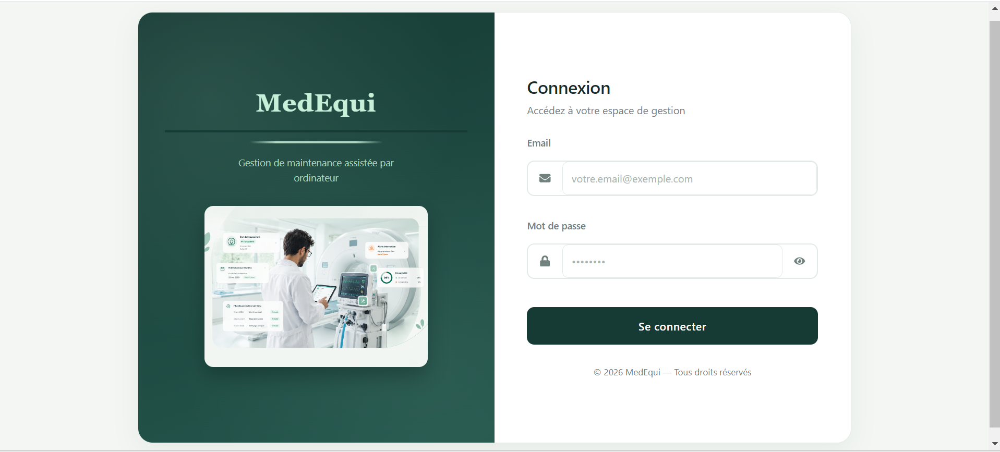
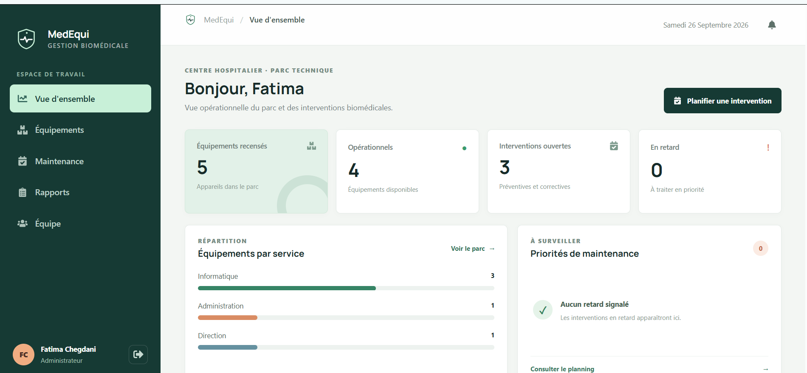
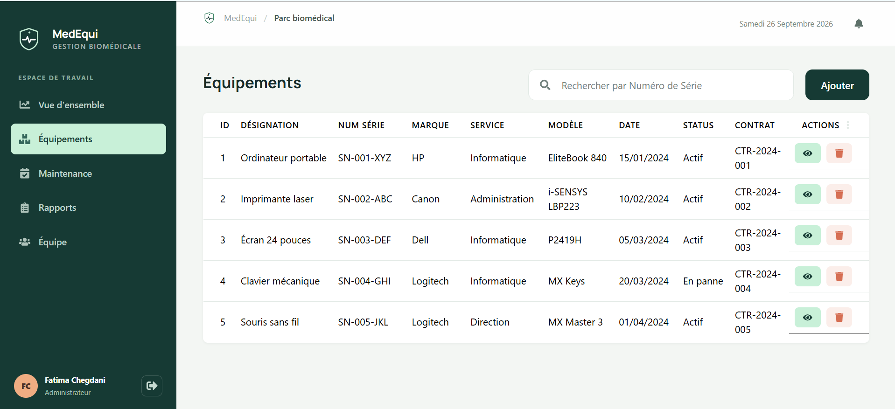
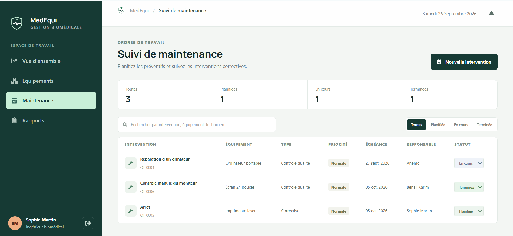
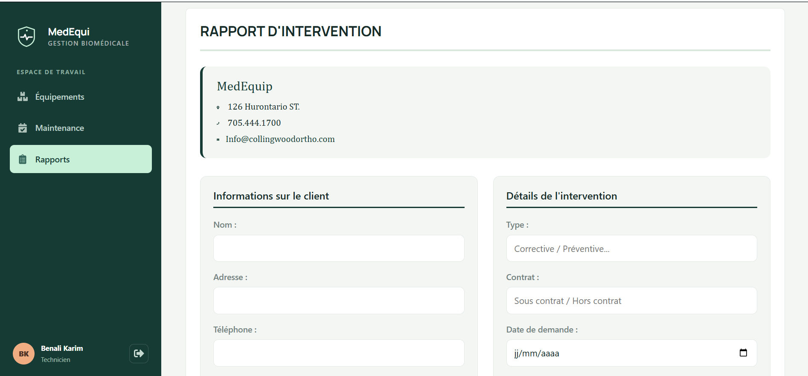
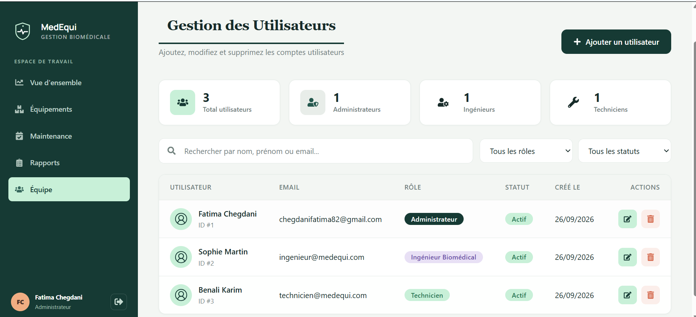
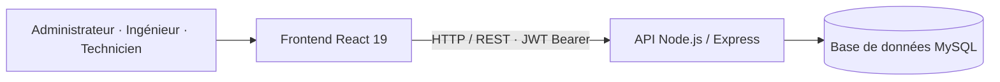

<div align="center">

# 🩺 MedEqui

### La GMAO pensée pour les équipements médicaux

Suivez, planifiez et documentez la maintenance de vos équipements biomédicaux, avec des accès adaptés à chaque métier : **Administrateur · Ingénieur · Technicien**.


[À propos](#-à-propos-du-projet) ·
[Fonctionnalités](#-fonctionnalités-principales) ·
[Rôles](#-gestion-des-rôles) ·
[Aperçu](#-aperçu-de-lapplication) ·
[Installation](#-installation)

</div>

---

## 🎯 À propos du projet

Dans un établissement de santé, la disponibilité des équipements médicaux est essentielle. Une panne non suivie, une maintenance oubliée ou l'absence d'historique d'intervention peuvent entraîner des interruptions d'activité, des coûts imprévus et une traçabilité insuffisante.

**MedEqui** est une application de **GMAO** (Gestion de Maintenance Assistée par Ordinateur) qui centralise le cycle de maintenance des équipements biomédicaux : de leur enregistrement à la planification des interventions, jusqu'à la conservation des rapports techniques.

| Objectif | Solution MedEqui |
|---|---|
| Centraliser les équipements | Gestion du parc biomédical |
| Organiser la maintenance | Création et suivi des ordres de maintenance |
| Assurer la traçabilité | Rapports et historique des interventions |
| Sécuriser les accès | Authentification et permissions par rôle |

## ✨ Fonctionnalités principales

### 📊 Tableau de bord
- Vue synthétique de l'activité et des indicateurs de maintenance
- Suivi de l'état des équipements et des ordres de maintenance

### 🏥 Gestion du parc d'équipements
- Ajouter, consulter et modifier les fiches d'équipements
- Consulter les informations du parc selon les permissions du compte

### 🛠️ Ordres de maintenance
- Créer des ordres et affecter les interventions
- Suivre les statuts et l'avancement des opérations

### 📝 Rapports d'intervention
- Enregistrer les informations et les actions d'une intervention
- Conserver un historique consultable des rapports techniques

### 🔔 Notifications
- Consulter les notifications liées à l'activité depuis l'application

### 👥 Gestion des utilisateurs
- Gérer les comptes et les rôles d'administrateur, d'ingénieur et de technicien

### 🔐 Authentification et sécurité
- Authentification par JWT Bearer signé en HS256, avec expiration après 8 heures
- Mots de passe hachés avec bcrypt
- Routes API protégées et permissions contrôlées selon le rôle
- Clé JWT privée configurée dans un fichier `.env` non versionné

## 👥 Gestion des rôles

MedEqui applique un contrôle d'accès par rôle (RBAC) :

| Fonctionnalité | Administrateur | Ingénieur | Technicien |
|---|:---:|:---:|:---:|
| Tableau de bord | ✅ | ✅ | — |
| Utilisateurs | ✅ | — | — |
| Équipements | ✅ Gestion | ✅ Gestion | 👁️ Consultation |
| Maintenance | ✅ Gestion | ✅ Gestion | ✏️ Mise à jour |
| Rapports | ✅ Gestion | ✅ Gestion | ✅ Création |

## 🖥️ Aperçu de l'application

| Connexion | Tableau de bord |
|---|---|
|  |  |

| Équipements | Maintenance |
|---|---|
|  |  |

| Rapports d'intervention | Utilisateurs |
|---|---|
|  |  |

## 🏗️ Architecture du projet

```text
MedEqui/
├── backend/
│   ├── config/db.js                 # Connexion et initialisation MySQL
│   ├── database/database.sql        # Schéma et comptes de démonstration
│   ├── server.js                    # API Express et routes métier
│   ├── package.json
│   └── .env.example                 # Exemple de configuration backend
├── frontend/
│   ├── public/                      # Ressources et images
│   ├── src/                         # Application React, pages et authentification
│   ├── package.json
│   └── .env.example                 # URL de l'API
├── docs/screenshots/                # Captures d'écran
├── package.json                     # Commandes pratiques à la racine
└── README.md
```

### Architecture technique



## 🧰 Stack technologique

| Domaine | Technologies |
|---|---|
| Frontend | React 19, React Router, CSS |
| Backend | Node.js, Express |
| API | API REST |
| Base de données | MySQL, mysql2 |
| Authentification | JWT (jsonwebtoken), bcrypt |
| Interface | React Icons, Font Awesome, Bootstrap |
| Configuration | dotenv |

## 🚀 Installation

### Prérequis

- Node.js et npm
- MySQL (par exemple via XAMPP, WAMP ou MySQL Server)

### 1. Récupérer le projet

```bash
git clone https://github.com/Fatima1234-cheg/MedEqui.git
cd MedEqui
```

### 2. Installer et configurer le backend

Dans PowerShell, depuis le dossier du projet :

```powershell
Copy-Item backend\.env.example backend\.env
Set-Location backend
npm install
```

Modifiez `backend/.env` avec les paramètres de votre serveur MySQL. Le fichier d'exemple utilise le port `3307`; si votre MySQL écoute sur `3306`, changez `DB_PORT`.

Générez une clé JWT privée avec Node.js :

```bash
node -e "console.log(require('crypto').randomBytes(64).toString('hex'))"
```

Copiez la valeur générée dans `backend/.env` :

```env
JWT_SECRET=votre_cle_aleatoire_generee
```

Ne partagez pas cette clé et ne l'ajoutez jamais à Git.

### 3. Initialiser la base MySQL

Importez le script `backend/database/database.sql` dans MySQL à l'aide de phpMyAdmin ou de votre client MySQL. Le script crée la base `medequi`, ses tables et des comptes de démonstration.

Vérifiez la connexion à la base depuis le dossier du projet :

```powershell
Set-Location ..
npm run test:db
```

### 4. Démarrer l'API

Depuis `backend/` :

```bash
npm start
```

L'API démarre sur `http://localhost:8081`.

### 5. Installer et démarrer le frontend

Ouvrez un second terminal à la racine du projet :

```powershell
Set-Location frontend
npm install
npm start
```

L'application React s'ouvre sur `http://localhost:3000`. Si nécessaire, configurez l'URL de l'API dans `frontend/.env` à partir de `frontend/.env.example`.

## 🔑 Comptes de démonstration

Ces comptes sont insérés par `backend/database/database.sql`. Ils sont disponibles après l'importation du script :

| Rôle | Adresse e-mail | Mot de passe |
|---|---|---|
| Administrateur | `chegdanifatima82@gmail.com` | `Admin123!` |
| Ingénieur | `ingenieur@medequi.com` | `Ingenieur123!` |
| Technicien | `technicien@medequi.com` | `Technicien123!` |

Pour un usage réel, remplacez ou supprimez ces comptes de démonstration et utilisez des identifiants forts.

## 🔄 Exemple de workflow

```text
Équipement enregistré
        ↓
Maintenance nécessaire
        ↓
Ordre de maintenance créé et affecté
        ↓
Intervention du technicien
        ↓
Rapport d'intervention enregistré
        ↓
Historique de maintenance consultable
```

## 🗺️ Évolutions possibles

- [ ] Automatisation de la maintenance préventive
- [ ] Export des rapports en PDF
- [ ] Historique détaillé par équipement
- [ ] Gestion des pièces de rechange
- [ ] Planification sous forme de calendrier
- [ ] Statistiques avancées
- [ ] Améliorations du système de notifications

---

<div align="center">

**MedEqui — Centraliser · Planifier · Maintenir · Tracer**

⭐ Si le projet vous plaît, laissez une étoile au dépôt !

</div>
